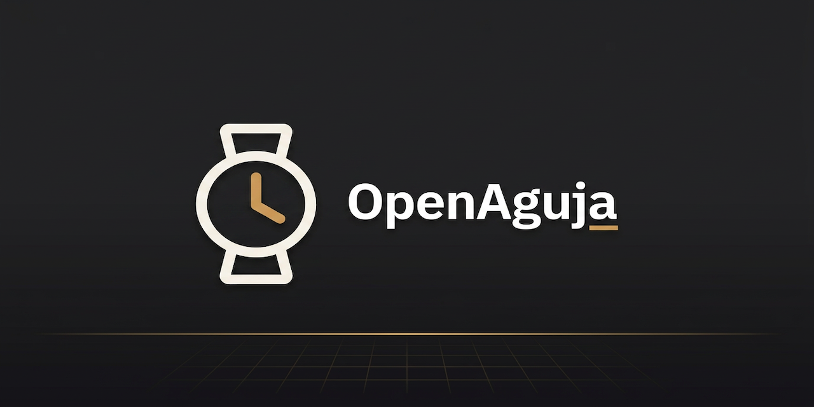
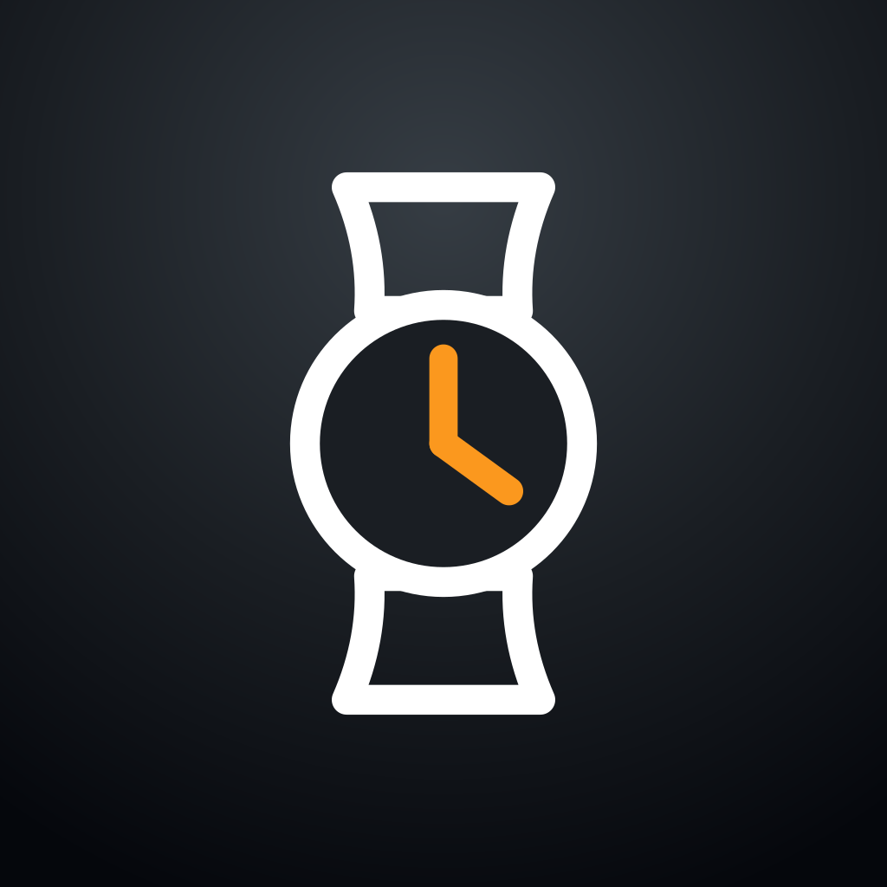

<p align="center">
  
</p>

# OpenAguja

Unofficial open-source iOS companion app, CLI and protocol library for
ZeTime hybrid smartwatches.

<p align="center">
  
</p>

## What it does

- **Full watch control over BLE** — settings, alarms & reminders,
  quick replies, activity/sleep/heart-rate sync, watchfaces, weather
  and calendar push, all through a Rust protocol core shared with the
  CLI and the iOS app (UniFFI).
- **Watch actions → anywhere** — every button, crown gesture, music
  control, SOS, find-phone and quick reply can be routed per context
  mode to a webhook, Apple Music, Shortcuts, a Mac daemon or the
  iPhone itself.
- **Data-driven routing modes** — import/export your whole setup as a
  JSON profile; no personal config ships in the repo.
- **Telemetry pipeline** — decoded watch telemetry uploads to your own
  endpoint as JSON lines, with daily-summary history.
- **Mac daemon** — `openaguja-macd` turns watch actions into shell
  commands on your computer.
- **CLI + library** — the same safe command set from the terminal or
  your own Rust code.

<!-- Screenshot placeholder: add app screenshots here -->

## Install

Not on the App Store — see [docs/INSTALL.md](docs/INSTALL.md):
unsigned IPA from [GitHub Releases](https://github.com/hquezser/openaguja/releases)
(SideStore or AltStore signs it locally), or build from source with
your own signing identity.

## Customize

No personal URLs or device ids in the source — everything is
configuration:
[docs/CUSTOMIZATION.md](docs/CUSTOMIZATION.md) (in-app settings,
webhook, Shortcuts, macd, own build, CLI). For on-watch image-partition
tooling (menu icons, boot logo, OTA header, memory dumps) see the
companion repo
[OpenAguja Lab](https://github.com/hquezser/openaguja-lab).

## Development

Checks run in CI (`.github/workflows/ci.yml`): Rust fmt/clippy/tests
and `scripts/public-check.sh` — a privacy guard that fails if personal
infrastructure, the professional email, or private routine names ever
reach a published file or commit history. The macOS checks
(`scripts/swift-check.sh`, unsigned iOS build) are in
`.github/workflows/macos.yml`, manual-trigger for now — hosted macOS
runners aren't assigned to this account yet; run them locally before
pushing (see AGENTS.md). Enable the privacy guard locally:

```sh
scripts/install-hooks.sh   # pre-push → scripts/public-check.sh
```

## Protocol

The wire protocol is reverse-engineered and documented in
[docs/PROTOCOL.md](docs/PROTOCOL.md); dangerous opcodes and brick
risks in [docs/SAFETY.md](docs/SAFETY.md).

## Credits

- Protocol encoders partly ported from
  [Gadgetbridge](https://codeberg.org/Freeyourgadget/Gadgetbridge)
  (AGPL-3.0) and the [ZeTime Android app](https://zetime.artificialred.nl)
  (MIT) — see [NOTICE](NOTICE).
- Weather data via [Open-Meteo](https://open-meteo.com).
- ZeTime is a trademark of MyKronoz/Kronoz, used here only to describe
  compatibility.

## License

[AGPL-3.0-or-later](LICENSE) — © 2026 Hougo and OpenAguja contributors.

## Disclaimer

OpenAguja is **not affiliated with, endorsed by, or supported by
MyKronoz/Kronoz**. "ZeTime" is their trademark, used only to describe
which device this software is compatible with. The protocol was
reverse-engineered for interoperability.

Use at your own risk: unofficial BLE commands can misbehave, and
firmware-level operations can **brick your watch**. No warranty of any
kind is provided.
